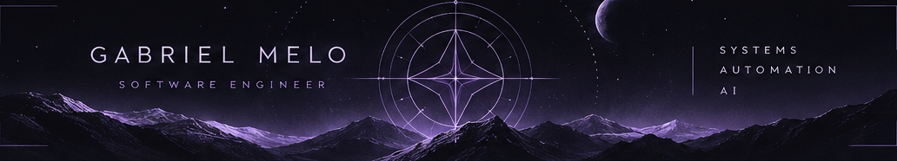
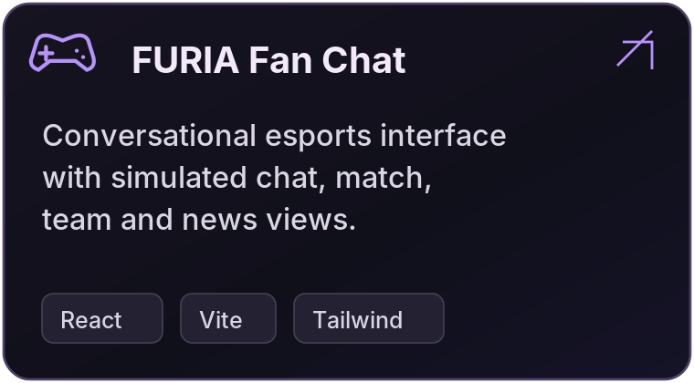
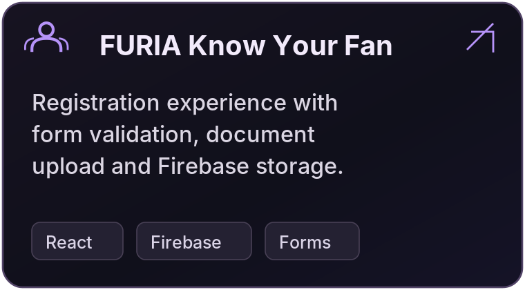
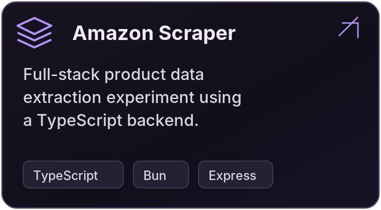
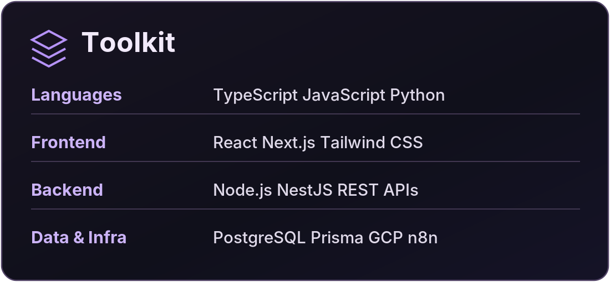
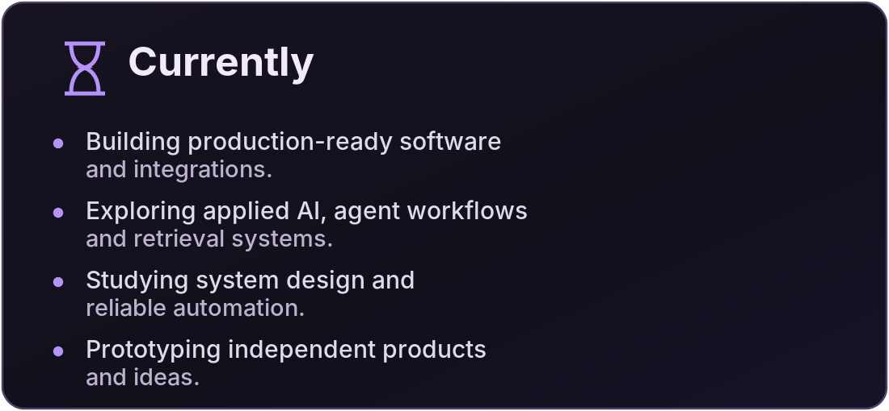

## Hi, I'm Gabriel

**Software Engineer · Systems, Automation & Applied AI**

I build and maintain software systems that connect products, data, and operations. My work spans backend services, interfaces, integrations, and automation, with a growing focus on applied AI.

Based in Brazil · **Computer Engineering @ UFG**

[LinkedIn](https://www.linkedin.com/in/gabriel-melo-dos-santos/) · [Email](mailto:gabrielmds0306@gmail.com) · [All repositories](https://github.com/gabrielmds0?tab=repositories)

 

---

## Featured projects

  
  
  

Most of my production work lives in private repositories. These are public experiments and projects; I share technical write-ups when appropriate.

---

  
  

Tooling and current work in text

**Languages:** TypeScript, JavaScript, Python  
**Frontend:** React, Next.js, Tailwind CSS  
**Backend:** Node.js, NestJS, REST APIs  
**Data & infrastructure:** PostgreSQL, Prisma, GCP, n8n

Right now, I work on production software and integrations, explore applied AI and agent workflows, and study system design and reliable automation.

---

### Outside the editor

Outside software, I run, lift, play beach volleyball, and study languages.

---

<i>Curiosity, discipline, and iteration.</i>

