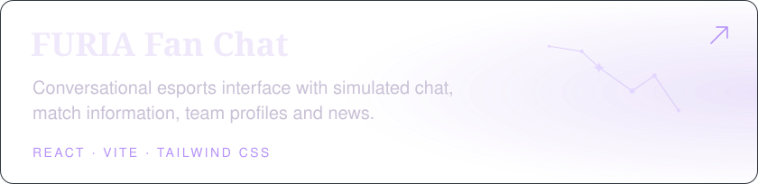
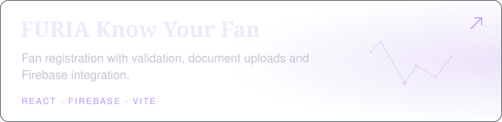

### Hi, I'm Gabriel

**I turn complex workflows into reliable software.**

I build backend services, integrations, and automations that connect products, data, and day-to-day operations. I'm also exploring applied AI where it can reduce manual work.

Software Engineer · Computer Engineering @ UFG · Brazil

[LinkedIn](https://www.linkedin.com/in/gabriel-melo-dos-santos/) &nbsp;·&nbsp; [Email](mailto:gabrielmds0306@gmail.com) &nbsp;·&nbsp; [All repositories](https://github.com/gabrielmds0?tab=repositories)

<picture><source media="(prefers-color-scheme: light)" srcset="./assets/profile/horizon-intro-light.svg"></picture>

### Featured projects

<a href="https://github.com/gabrielmds0/FuriaFanChat"><picture><source media="(max-width: 600px) and (prefers-color-scheme: light)" srcset="./assets/profile/furia-fan-chat-light-m.svg"><source media="(max-width: 600px)" srcset="./assets/profile/furia-fan-chat-dark-m.svg"><source media="(prefers-color-scheme: light)" srcset="./assets/profile/furia-fan-chat-light.svg"></picture></a>
<a href="https://github.com/gabrielmds0/FuriaKnowYourFan"><picture><source media="(max-width: 600px) and (prefers-color-scheme: light)" srcset="./assets/profile/furia-know-your-fan-light-m.svg"><source media="(max-width: 600px)" srcset="./assets/profile/furia-know-your-fan-dark-m.svg"><source media="(prefers-color-scheme: light)" srcset="./assets/profile/furia-know-your-fan-light.svg"></picture></a>
<a href="https://github.com/gabrielmds0/AmazonScraper"><picture><source media="(max-width: 600px) and (prefers-color-scheme: light)" srcset="./assets/profile/amazon-scraper-light-m.svg"><source media="(max-width: 600px)" srcset="./assets/profile/amazon-scraper-dark-m.svg"><source media="(prefers-color-scheme: light)" srcset="./assets/profile/amazon-scraper-light.svg"></picture></a>

Most of my production work lives in private repositories. These are public experiments; I share technical write-ups when appropriate.

### Toolkit

<picture><source media="(max-width: 600px) and (prefers-color-scheme: light)" srcset="./assets/profile/toolkit-light-m.svg"><source media="(max-width: 600px)" srcset="./assets/profile/toolkit-dark-m.svg"><source media="(prefers-color-scheme: light)" srcset="./assets/profile/toolkit-light.svg"></picture>

### Currently

&nbsp; Building production software and integrations. 
&nbsp; Exploring applied AI, agent workflows, and retrieval systems. 
&nbsp; Studying system design and reliable automation. 
&nbsp; Prototyping independent products and ideas.

<picture><source media="(prefers-color-scheme: light)" srcset="./assets/profile/horizon-sky-light.svg"></picture>

### Contribution sky

<!-- sky:start --><!-- sky:end -->

One star per day, laid out like the contribution calendar below. The highlighted figure is my longest streak. Redrawn daily by a GitHub Action; most of these commits land in private repositories at work.

### Outside the editor

I run, lift, play beach volleyball, and study languages.

<picture><source media="(prefers-color-scheme: light)" srcset="./assets/profile/footer-light.svg"></picture>
