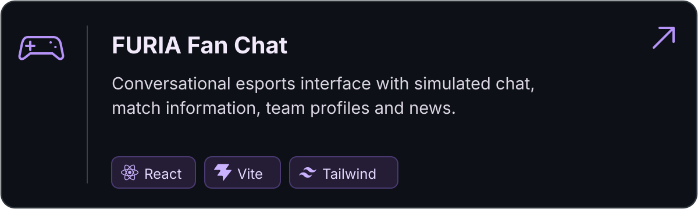
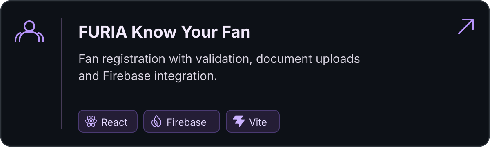
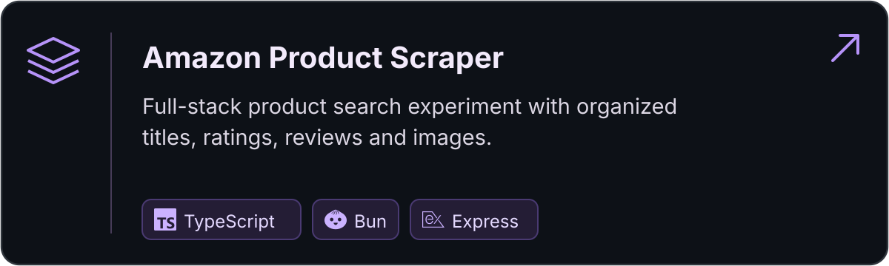
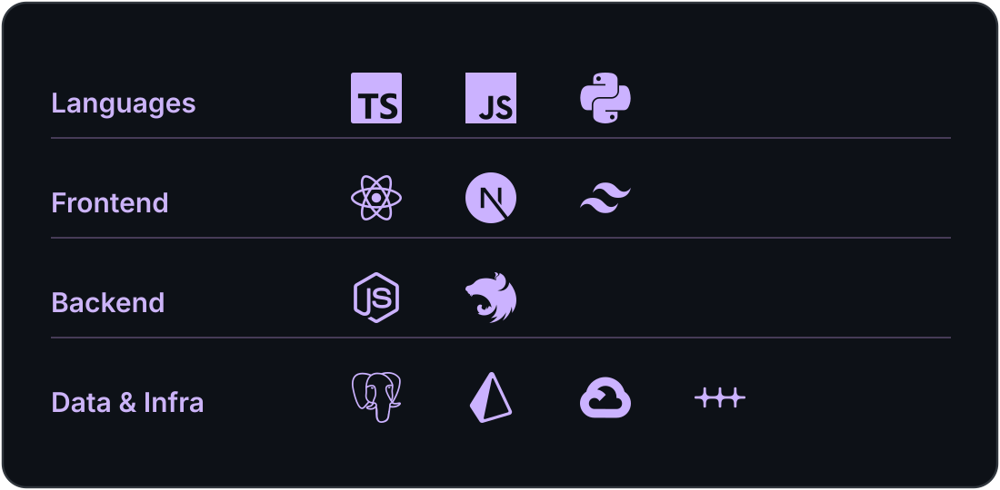

## Hi, I'm Gabriel

**Software Engineer · Systems, Automation & Applied AI**

**I turn complex workflows into reliable software.**

I build backend services, integrations, and automations that connect products, data, and day-to-day operations. I'm also exploring applied AI where it can reduce manual work.

Based in Brazil · **Computer Engineering @ UFG**

[LinkedIn](https://www.linkedin.com/in/gabriel-melo-dos-santos/) · [Email](mailto:gabrielmds0306@gmail.com) · [All repositories](https://github.com/gabrielmds0?tab=repositories)

 

---

## Featured projects

  
  
  

Project details and technologies

**[FURIA Fan Chat](https://github.com/gabrielmds0/FuriaFanChat)** — An esports chat experience with simulated conversations, match information, team profiles, and news.

  

**[FURIA Know Your Fan](https://github.com/gabrielmds0/FuriaKnowYourFan)** — Fan registration with form validation, document uploads, and Firebase integration.

  

**[Amazon Product Scraper](https://github.com/gabrielmds0/AmazonScraper)** — A full-stack experiment that searches product listings and displays organized results.

  

Most of my production work lives in private repositories. These are public experiments and projects; I share technical write-ups when appropriate.

---

## Toolkit

  

Toolkit in text

**Languages:** TypeScript, JavaScript, Python 
**Frontend:** React, Next.js, Tailwind CSS 
**Backend:** Node.js, NestJS, REST APIs 
**Data & infrastructure:** PostgreSQL, Prisma, Google Cloud, n8n

## Currently

  

- Building production software and integrations.
- Exploring applied AI, agent workflows, and retrieval systems.
- Studying system design and reliable automation.
- Prototyping independent products and ideas.

---

## Professional work

I build and maintain production software, integrations, and internal tools that connect systems and help streamline day-to-day workflows. Most of this work lives in private repositories.

### Outside the editor

Outside software, I run, lift, play beach volleyball, and study languages.

---

<i>Curiosity, discipline, and iteration.</i> 
<a href="mailto:gabrielmds0306@gmail.com">Email</a> · <a href="https://www.linkedin.com/in/gabriel-melo-dos-santos/">LinkedIn</a>

